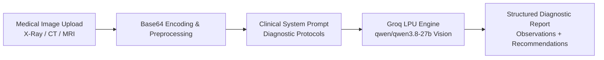

# 🩺 AI Medical Diagnostic Assistant

[](https://www.python.org/)
[](https://streamlit.io)
[](https://groq.com)
[](LICENSE)

An intelligent, high-speed clinical decision-support application built with **Streamlit** and powered by **Groq LPU Vision AI** (`qwen/qwen3.8-27b`). The system assists healthcare professionals in interpreting medical imaging modalities (X-rays, CT scans, MRIs, and ultrasounds) with structured, objective, and domain-grounded diagnostic insights.

---

## 🌟 Key Features

- **Multimodal Medical Vision Analysis**: Real-time diagnostic evaluation of medical scans (PNG, JPG, JPEG).
- **Sub-Second LPU Inference**: Powered by Groq's high-performance Language Processing Units (LPU) for instantaneous results.
- **Structured Clinical Reporting**:
  - Detailed visual and structural observations
  - Differential diagnoses ranked by likelihood and severity
  - Recommended confirmatory diagnostic workflows (e.g., contrast MRI, biopsy, blood panels)
- **Zero API Key Leakage**: Secure key management via environment variables (`.env`), Streamlit secrets, or interactive in-app sidebar inputs.
- **Original Branding & UI**: Clean, modern, responsive interface built specifically for clinical workflows.

---

## 🔬 Diagnostic Detection Scope

The underlying clinical reasoning prompt evaluates medical imaging across multiple critical domains:

| Category | Targeted Conditions |
| :--- | :--- |
| **Oncology** | Benign and malignant tumors, lung nodules, breast lesions, intracranial masses. |
| **Cardiovascular** | Cardiomegaly, aortic aneurysms, ischemic stroke signs, vascular calcification. |
| **Neurology** | Intracranial hemorrhage, acute infarcts, multiple sclerosis lesions, cerebral atrophy. |
| **Pulmonology** | Pneumonia, tuberculosis infiltrates, pneumothorax, chronic obstructive pulmonary disease (COPD). |
| **Musculoskeletal** | Bone fractures, joint dislocations, degenerative arthritis, osteolytic lesions. |
| **Gastrointestinal** | Cirrhosis patterns, bowel obstruction, inflammatory bowel indications. |

---

## 🏗️ Architecture & Workflow



---

## 🚀 Quick Start Guide

### 1. Clone the Repository
```bash
git clone https://github.com/your-username/medical-diagnose-assistant.git
cd medical-diagnose-assistant
```

### 2. Set Up a Virtual Environment
```bash
# Windows
python -m venv .venv
.\.venv\Scripts\activate

# macOS / Linux
python3 -m venv .venv
source .venv/bin/activate
```

### 3. Install Dependencies
```bash
pip install -r requirements.txt
```

### 4. Configure Your Groq API Key
Get your free API key from the [Groq Console](https://console.groq.com/keys).

You can supply the key in any of the following three secure ways:

- **Option A (Environment Variable)**:
  ```bash
  # Windows PowerShell
  $env:GROQ_API_KEY="gsk_your_key_here"

  # Linux / macOS
  export GROQ_API_KEY="gsk_your_key_here"
  ```
- **Option B (.env file)**:
  Copy `.env.example` to `.env` and fill in your key:
  ```bash
  cp .env.example .env
  ```
- **Option C (Interactive UI)**:
  Leave it blank and enter your key directly into the secure password field in the web app sidebar!

### 5. Launch the Application
```bash
streamlit run main.py
```
Open **`http://localhost:8501`** in your browser.

---

## 📁 Repository Structure

```
medical-diagnose-assistant/
├── diagnose.png            # Application logo
├── medical.png             # Healthcare team visual
├── main.py                 # Core Streamlit application & Groq inference logic
├── requirements.txt        # Python dependencies
├── .env.example            # Environment configuration template
├── .gitignore              # Files excluded from version control
└── README.md               # Documentation
```

---

## 🔒 Security & Privacy

- **No Hardcoded Credentials**: API keys are never stored in source code.
- **Ephemeral Processing**: Uploaded medical images are processed in-memory and converted to temporary base64 buffers; no patient files are stored on disk.
- **Git Protection**: `.gitignore` is configured to exclude all `.env` files, virtual environments, and temporary artifacts.

---

## ⚖️ Medical Disclaimer

> **IMPORTANT**: This application is an **AI-assisted clinical decision-support tool** intended solely for research, educational, and demonstration purposes. It is **not** a certified medical diagnostic device and does **not** replace the professional clinical judgment, diagnosis, or treatment plan of a licensed physician or radiologist. Always consult qualified healthcare professionals for medical evaluations.

---

## 📄 License

This project is licensed under the [MIT License](LICENSE).
